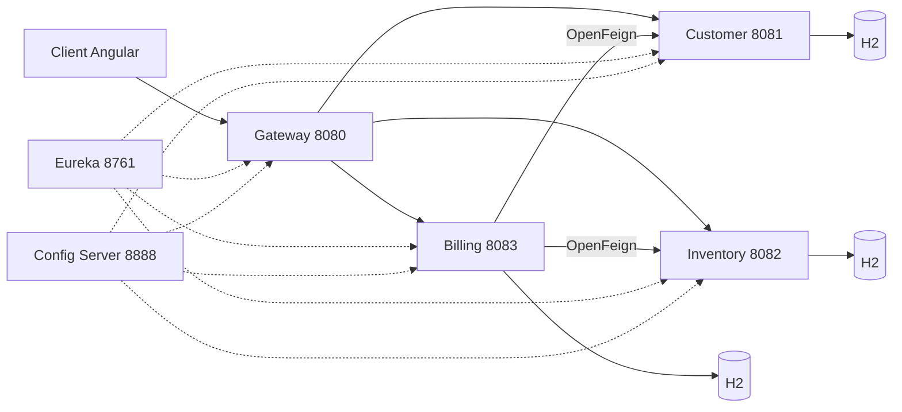

# Rapport de TP N°2 — Architecture Microservices avec Spring Cloud

**École :** ENSET  
**Matière :** Systèmes Distribués et DevOps (II-BDCC3)  
**Enseignant :** Mohamed YOUSSFI  
**Étudiant :** [Nom à compléter]  
**Année :** 2026–2027

## 1. Contexte et objectifs

Réaliser une application de facturation en architecture microservices. Chaque facture appartient à un client et contient des lignes de produits. Le projet illustre la séparation des responsabilités, la découverte de services, le routage et la configuration externalisée.

## 2. Architecture générale

### Ports et responsabilités

| Port | Service | Responsabilité |
|---|---|---|
| 8761 | discovery-service | Annuaire Eureka |
| 8888 | config-service | Configuration Spring Cloud Config |
| 8081 | customer-service | Données clients |
| 8082 | inventory-service | Catalogue et stocks produits |
| 8083 | billing-service | Factures et lignes, appel Feign |
| 8080 | gateway-service | Entrée API commune |
| 4200 | web-client | Application Angular |

## 3. Réalisation des 9 consignes

### 3.1 Customer Service

Entité JPA `Customer (id,name,email)`, `CustomerRepository`, `CustomerController` (GET, POST, PUT, DELETE). H2 indépendant et données de démonstration. **Capture à ajouter** : liste JSON des clients dans Postman.

### 3.2 Inventory Service

Entité `Product (id,name,price,quantity)`, dépôt JPA et endpoints CRUD. **Capture** : liste des produits et IDs.

### 3.3 Spring Cloud Gateway

`gateway-service` sur le port 8080. Toute demande du frontend utilise le préfixe `/api` et est redirigée vers le service pertinent. **Capture** : appel GET via `localhost:8080/api/customers`.

### 3.4 Configuration statique

Profil Spring `static`, routes de type `http://localhost:8081` et `http://localhost:8082`. Ce routage suppose un emplacement fixe des services. **Capture** : fichier `application.yml` (section `static`) et test Postman.

### 3.5 Eureka Discovery Service

`@EnableEurekaServer` ; interface `http://localhost:8761`. Les autres microservices s'enregistrent avec un nom logique. **Capture** : écran Eureka montrant `CUSTOMER-SERVICE`, `INVENTORY-SERVICE`, `BILLING-SERVICE`, `GATEWAY-SERVICE`.

### 3.6 Configuration dynamique de la Gateway

Profil `dynamic` et destinations `lb://customer-service`, `lb://inventory-service`, `lb://billing-service`. Spring Cloud LoadBalancer résout les instances via Eureka ; le locator de découverte est aussi activé. **Capture** : yml et requête réussie via Gateway.

### 3.7 Billing Service avec OpenFeign

`Bill` et `BillItem` ont leur propre persistance. Lors de la création d'une facture, Feign obtient le client et les produits. Calcul de `total = somme(quantité × prix unitaire)`. Les prix et noms sont enregistrés au moment de l'émission. **Capture** : POST facture avec plusieurs lignes + réponse JSON enrichie.

### 3.8 Configuration Service

`@EnableConfigServer`, backend natif local, fichiers `config-repo/customer-service.yml`, `inventory-service.yml`, `billing-service.yml`. `billing-service.yml` contient `app.billing.currency=MAD` et `app.billing.max-items=20`. **Capture** : GET `http://localhost:8888/billing-service/default`.

### 3.9 Angular

Application Angular autonome : vue générale, clients, produits, factures, création et affichage détaillé. Proxy Angular vers Gateway (en local), proxy Nginx vers Gateway (Docker). **Capture** : tableau de bord et facture créée dans l'interface.

## 4. Tests et critères de validation

| Vérification | Attendu | Réel |
|---|---|---|
| `mvn clean test` | Tests JPA + test billing réussis | **À exécuter** |
| Eureka `:8761` | Services enregistrés | **À vérifier** |
| Config Server | Réponse JSON pour billing-service | **À vérifier** |
| Static Gateway | HTTP 200 GET customers | **À vérifier** |
| Dynamic Gateway | HTTP 200 via Eureka | **À vérifier** |
| POST facture | Total correct + client + 2 lignes | **À vérifier** |
| Angular | Création et affichage facture | **À vérifier** |

> Aucune de ces exécutions n'a été vérifiée au moment de rédiger ce rapport. Remplir les résultats observés et insérer vos captures réelles avant toute affirmation de succès.

## 5. Limites et améliorations

- H2 en mémoire pour démonstration ; utiliser PostgreSQL pour persistance durable.
- Validation des quantités, **sans réservation ni réduction de stock** ; une application de production devrait mettre en place Saga / Outbox ou transactions coordonnées par événements.
- Les appels Feign synchrones peuvent échouer si un service est indisponible ; ajouter timeout, circuit breaker, retry contrôlé et tracing distribué.
- Aucune authentification ; Spring Security/OAuth2 peut être ajouté.
- Exemple à but pédagogique, pas une architecture production.

## 6. Conclusion

Cette réalisation découple les clients, produits et factures en services indépendants, réunit les API derrière Gateway, découvre les instances via Eureka, externalise la configuration et consomme les données distantes par OpenFeign. Angular sert de client web à l'architecture.

## Références

- https://www.youtube.com/watch?v=kOVHzN8I8e8
- https://www.youtube.com/watch?v=-iM3J_mgqIM
- https://www.youtube.com/watch?v=-G2rcLMO1gQ
- https://github.com/mohamedYoussfi/micro-services-app
