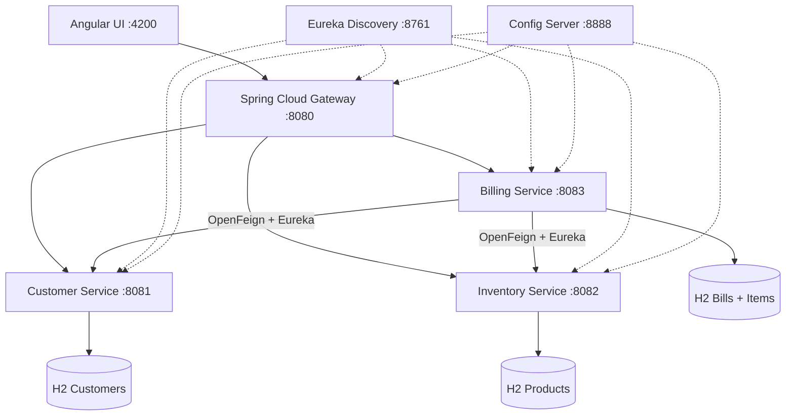

# TP2 — Architecture Microservices avec Spring Cloud

**ENSET · Systèmes Distribués et DevOps · II-BDCC3 · Professeur Mohamed YOUSSFI**

Projet pédagogique développé à partir des **9 consignes du Google Classroom** : gestion de clients, produits et factures ; Spring Cloud Gateway (routage statique et dynamique), Eureka Discovery, OpenFeign, Config Server et client Angular.

> **Statut** : structure, fichiers et configurations vérifiés statiquement. Le build Maven, le build Angular et l'exécution intégrée Docker n'ont **pas** été validés dans cet environnement. Tester localement et joindre de vraies captures avant remise. C'est une **implémentation indépendante**, pas une reproduction ligne par ligne des vidéos.

## 1. Architecture



## 2. Correspondance exacte avec le travail demandé

| # | Travail demandé | Réalisation |
|---|---|---|
| 1 | customer-service | CRUD REST, JPA, H2, données de démonstration |
| 2 | inventory-service | CRUD REST produits, prix/quantité, JPA H2 |
| 3 | Spring Cloud Gateway | module `gateway-service` |
| 4 | Routage **statique** | profil `static` : URL localhost:8081/8082/8083 |
| 5 | Eureka Discovery Service | module `discovery-service` |
| 6 | Routage **dynamique** | profil `dynamic` : `lb://...` via Eureka + discovery locator |
| 7 | Billing-Service avec OpenFeign | factures, lignes, clients et produits via Feign |
| 8 | Config Service | `config-service`, dépôt local (`native`) versionnable |
| 9 | Client Angular | `web-client` : dashboard, formulaires clients/produits/factures |

## 3. Prérequis

- **Java 21**, Maven 3.9+, IntelliJ IDEA
- **Node.js 20 ou 22**, npm, Angular CLI installé localement par npm (via `npm install`)
- **Docker Desktop** pour le démarrage intégré (optionnel)

## 4. Lancement rapide : Docker (recommandé)

À la racine, dans un terminal :

```bash
docker compose up --build -d
```

Le premier build télécharge les dépendances Maven et npm (connexion Internet nécessaire). **Patientez jusqu'à l'enregistrement des services dans Eureka** ; `depends_on` n'attend pas la disponibilité fonctionnelle. En cas de démarrage tardif, les clients Eureka retenteront leur enregistrement. Vérifier les logs :

```bash
docker compose ps
docker compose logs --tail=80 gateway-service billing-service
```

Ouvrir :

| Composant | URL |
|---|---|
| Angular | http://localhost:4200 |
| Gateway | http://localhost:8080/api/customers |
| Eureka | http://localhost:8761 |
| Config Server | http://localhost:8888/billing-service/default |
| Consumer REST Clients | via Gateway, voir tableau API ci-dessous |

> Dans Docker, le Gateway fonctionne avec **le profil `dynamic`**. Les URL internes sont des noms Docker (`customer-service`, etc.), et les instances sont découvertes dans Eureka.

## 5. Lancement IntelliJ / Maven (pour montrer statique et dynamique)

1. Ouvrir le dossier racine comme un **projet Maven multi-modules** puis synchroniser Maven.
2. Lancer `DiscoveryServiceApplication` (8761).
3. Lancer `ConfigServiceApplication` (8888), puis vérifier `http://localhost:8888/billing-service/default`.
4. Lancer `CustomerServiceApplication` (8081) et `InventoryServiceApplication` (8082).
5. Lancer `BillingServiceApplication` (8083), attendre la visibilité des 3 services dans Eureka.
6. Lancer `GatewayServiceApplication` (8080), avec variable d'environnement **`SPRING_PROFILES_ACTIVE=static`** ou **`dynamic`**.
7. Depuis `web-client` : `npm install` puis `npm start`; ouvrir `http://localhost:4200`. Le proxy Angular transmet `/api` à Gateway.

**Note** : les applications de données utilisent H2 en mémoire ; leur contenu redémarre à zéro après relance. Chaque service contient des données de démonstration qui sont créées au premier lancement.

### Routage statique (question 4)

Le profil `static` de `gateway-service/src/main/resources/application.yml` configure les cibles fixes :

- `/api/customers/**` → `http://localhost:8081`
- `/api/products/**` → `http://localhost:8082`
- `/api/bills/**` → `http://localhost:8083`

### Routage dynamique (question 6)

Le profil `dynamic` utilise les URIs `lb://customer-service`, `lb://inventory-service`, `lb://billing-service` (Eureka + LoadBalancer), ainsi que le DiscoveryClient locator. Exemple : `/api/bills/1` → instance du **billing-service** découverte automatiquement.

## 6. API REST de démonstration (via Gateway)

| Méthode | Route | Usage |
|---|---|---|
| GET | `/api/customers` | Liste clients |
| GET | `/api/customers/1` | Client |
| POST | `/api/customers` | Créer client |
| PUT | `/api/customers/1` | Modifier client |
| DELETE | `/api/customers/1` | Supprimer client |
| GET | `/api/products` | Liste produits |
| POST | `/api/products` | Créer produit |
| PUT | `/api/products/{id}` | Modifier produit |
| DELETE | `/api/products/{id}` | Supprimer produit |
| GET | `/api/bills` | Liste factures |
| GET | `/api/bills/{id}` | Facture enrichie avec client et lignes |
| GET | `/api/bills?customerId=1` | Factures client |
| POST | `/api/bills` | Émettre facture |

**Exemple de facture** : utiliser dans Postman un `customerId` existant et les `productId` renvoyés par `GET /api/products` :

```json
{
  "customerId": 1,
  "items": [
    {"productId": "COLLER-ID-PRODUIT-1", "quantity": 2},
    {"productId": "COLLER-ID-PRODUIT-2", "quantity": 1}
  ]
}
```

Le Billing Service lit le client et les produits via **OpenFeign + Eureka**, calcule `lineTotal` et le `total`, puis conserve le **snapshot** des données dans sa propre base H2. Il valide les stocks **sans décrémenter les quantités** : ce TP ne comporte pas de saga/transaction distribuée.

## 7. Tests, contrôles et rapport

- `mvn clean test` : tests JPA `CustomerRepositoryTest`, `ProductRepositoryTest` et test unitaire `BillingServiceTest`.
- `python scripts/smoke_test.py` : vérifie les API via Gateway et crée une facture d'essai après démarrage des services.
- `postman/TP2_Microservices.postman_collection.json` : collection importable ; remplacer les `productId` par des valeurs renvoyées par l'inventaire.
- `RAPPORT_TP2.md` : document en français avec architecture, preuves demandées, notes sur les limites et emplacements pour les captures d'écran réelles.

## 8. Références pédagogiques

- Vidéo 1 (professeur) : https://www.youtube.com/watch?v=kOVHzN8I8e8
- Vidéo 2 : https://www.youtube.com/watch?v=-iM3J_mgqIM
- Config Server : https://www.youtube.com/watch?v=-G2rcLMO1gQ
- Dépôt de référence du professeur : https://github.com/mohamedYoussfi/micro-services-app
- Documentation officielle : https://docs.spring.io/spring-cloud-gateway/reference/4.2/ ; https://docs.spring.io/spring-cloud-config/reference/4.2/

**Remarque** : ce dépôt utilise Spring Boot 3.4.5 / Spring Cloud 2024.0.1 et une application Angular indépendante ; le code n'est pas une copie du dépôt de référence.
